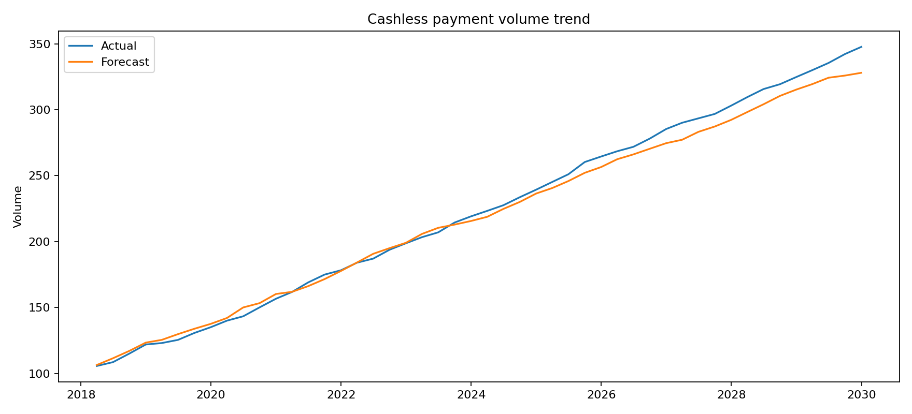
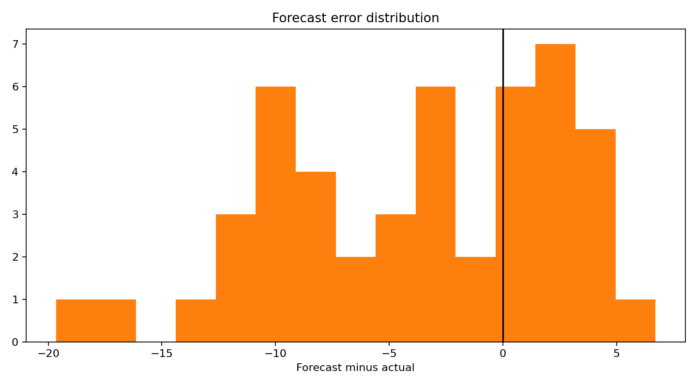

# Payment Volume Forecaster

## Objective

Cashless-payment volume forecasts help banks, acquirers and payment-service providers plan capacity, liquidity and customer-support operations. This project reconciles hierarchical payment observations into an auditable forecasting workflow that separates recurring seasonality from structural growth and highlights channel-level performance.

## Architecture

```text
Payment-Volume-Forecaster/
├── assets/
│   └── charts/                         # Trend and forecast-error visuals
├── data/
│   └── BIS_CPMI_CASHLESS_csv_flat.csv
├── notebooks/
│   └── Payment_forecasting.ipynb
├── src/
│   ├── data_pipeline.py                # BIS payment-data ingestion
│   ├── features.py                     # Seasonal lags and rolling baselines
│   ├── train.py                        # Time-ordered model training
│   ├── predict.py                      # Forecast generation
│   └── generate_charts.py              # Monitoring charts
└── tests/
```

## Quickstart

```bash
pip install -r requirements.txt
python -c "from src.data_pipeline import load_payments; from src.features import build_features; from src.train import train; train(build_features(load_payments('data/BIS_CPMI_CASHLESS_csv_flat.csv')))"
python -m src.generate_charts
```



The trend chart separates structural payment adoption from recurring seasonal movement. This distinction supports capacity planning and gives model owners a clear basis for challenging whether a forecast reflects business change or calendar effects.



The error distribution is a monitoring artefact rather than a decorative statistic. Persistent skew or stress-period concentration can indicate calibration drift, regime change or hierarchy-reconciliation weakness, informing targeted recalibration and review.
